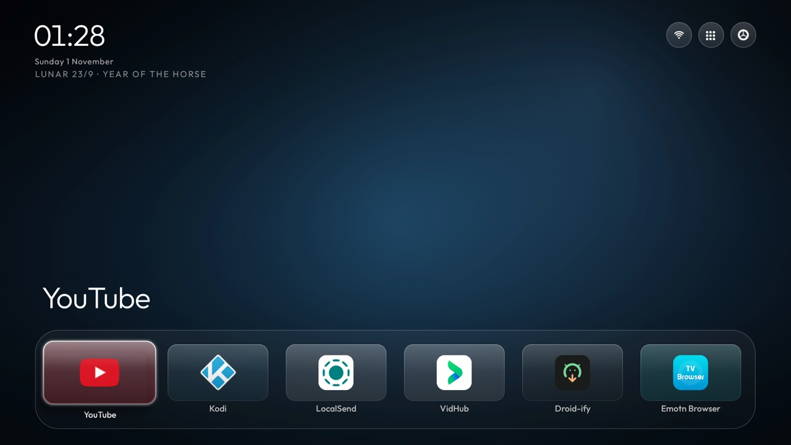

# CleanYourTV TVOS Skin

A skin for [CleanYourTV](https://github.com/Gathin23/cleanyourtv) that makes the home screen look like an
Apple TV one. One glass shelf at the bottom, see-through tiles instead of flat cards, thin line icons up in
the corner, and a clock that fades in when nobody has touched the remote in a while.

The launcher itself is Gathin's. All this does is change how it looks and how a few things behave. Same
offline launcher underneath, no new permissions, no network calls, nothing new to install on the side.



## What you actually get

**The shelf.** The dock sits at the bottom of the screen and the rows above it fade out, so you get one
line of apps and a hint that there is more if you scroll. Tapping Down brings the rest back. That is the
whole tvOS feel in one change, and it is the reason I started this.

**Glass, not blur.** Every plate behind an icon is sampled from the wallpaper right under it, lifted a
step brighter, and drawn semi-transparent with a hairline edge. It is not a blur filter. It reads as
actual glass because you can see the picture move through it, and it costs a lot less than a blur on a
1 GB TV.

**Icons redrawn.** The gear is hollow with a pierced hub, the Wi-Fi is thin arcs, and the app library
button is a 3x3 grid sized to sit next to them without looking heavier. The old filled shapes looked like
stickers on top of the glass; these sit in it.

**App library up in the corner.** The library moved from a pill on the dock to a button in the top bar,
next to Wi-Fi and Settings. Settings always stays rightmost.

**A clock that knows when to shut up.** The idle clock waits for real idleness. It checks
whether something is playing first and pushes itself back a minute if it is, so a movie does not get
interrupted by a screensaver ten minutes in.

**Two small fixes.** Back now opens the clock if you have that switch on (it silently did nothing before
on some builds). And the launcher no longer re-installs its key filter when it is not the Home app
anymore, which used to leave a button swallowed on whatever launcher you switched to.

## What it does not do

- No network permission, and none added. Nothing in this patch talks to anything.
- No new dependency, no new service, no new permission in the manifest. The manifest is untouched.
- No changes to the debloat side of the repo. This is launcher only.

## Putting it on your TV

You need the launcher source, JDK 17 and Android SDK 34, same as upstream.

```bash
git clone https://github.com/Gathin23/cleanyourtv.git
cd cleanyourtv
git checkout 57c00a40          # the main this patch was cut against

git apply --check ../patch/tvos-skin.patch    # dry run, should print nothing
git apply ../patch/tvos-skin.patch

cd launcher
./gradlew assembleRelease
```

Then install it the way the repo wants you to:

```bash
TV_HOST=<your-tv-ip> launcher/build-and-install.sh
```

If you already run the launcher and just want the skin, install over it and push the theme:

```bash
TV_HOST=<your-tv-ip> tools/theme.sh ../theme
```

The theme file is the whole look. Delete the theme (`tools/theme.sh --reset`) and you are back to stock
CleanYourTV without reinstalling anything.

## The theme file

`theme/config.json` is a full example with all 50 keys. The ones that do the heavy lifting:

| Key | What it does here |
|---|---|
| `dock_row` | Puts the dock on the bottom row |
| `rows_below_dock` | `0`, so only the shelf shows until you scroll |
| `dock_glass`, `dock_band` | The glass band behind the shelf |
| `glass_style` | `glass`, the sampled-glass renderer |
| `clock_wallpaper` | Big clock over the wallpaper |
| `home_idle_clock_minutes` | `10`, when the clock takes over |
| `date_below_clock`, `lunar_date` | Date and lunar line under the clock |
| `library_button`, `show_library_pill` | Library in the top bar instead of the dock |
| `icon_only_buttons`, `icon_only_inputs` | Icons, no text, in the top bar |
| `cinematic_home` | Off in this theme; on, the wallpaper takes the colour of the focused app |

Two things worth knowing if you copy it. `cinematic_home` recolours the whole background from the focused
app's art, which is fine for a photo-heavy wallpaper and not what you want if you picked one background
on purpose. And a wallpaper collection needs at least two images in `wallpapers/` or the launcher drops
the wallpaper entirely and draws its built-in gradient instead.

## A note on the 576 KiB gate

Upstream sets the release APK limit at 576 KiB, and `docs/INSTALL.md` writes it as 589,824 bytes without
saying why. It is the same number either way; the document now gives both, so nobody has to divide at the
terminal to check whether their build fits.

## What I tested

Short version: on one real TV, through a lot of reboots. The details, including the things that still
don't work, are in [docs/TESTED.md](docs/TESTED.md).

- Home handover, force-stop and reinstall, cold boot.
- D-pad from every edge of the grid, long presses with the remote itself rather than injected keys.
- Idle clock against something playing, and the clock coming back when it stops.
- Switching to the stock launcher and back: no leftover key filter, no stray screen tapping.
- App library picking up both TV and phone apps, and dropping them when they are uninstalled.

## Things I know are rough

- The dock-to-row transition is a fade, not the slide tvOS does. Doing it properly needs a layout pass I
  have not written.
- Non-Latin app names get tighter tile padding than Latin ones. It is readable, it is just not even.
- The fade under the shelf is one row tall. With `rows_below_dock` above 1 on a short grid the third row
  can disappear under the dock instead of fading, so keep it at 0 or 1 on a 1080p set until the fade is
  measured off the real gap.
- The clock only shows in 24-hour style on a 24-hour TV unless you set `clock_format`.
- Everything here was tuned on a 1080p panel. It should scale, but I have not seen it on a 4K set.

## Credits

Built on [CleanYourTV](https://github.com/Gathin23/cleanyourtv) by Gathin, MIT licensed. The launcher, the
config system, the theme tooling and most of the thinking are his. All I did was push the look around.

Full attribution and licences: [CREDITS.md](CREDITS.md).

## License

MIT. See [LICENSE](LICENSE).
